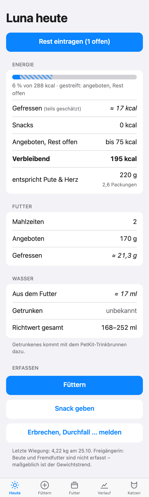
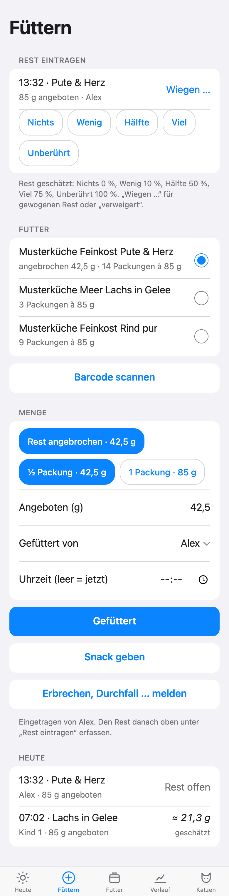
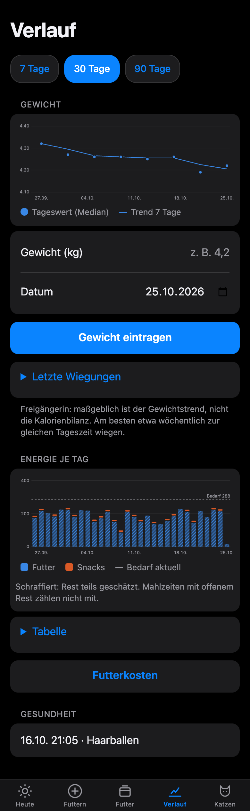
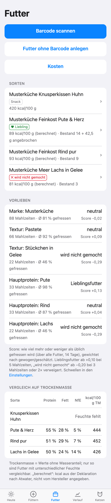
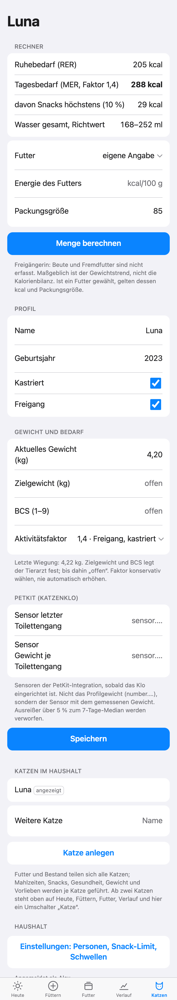
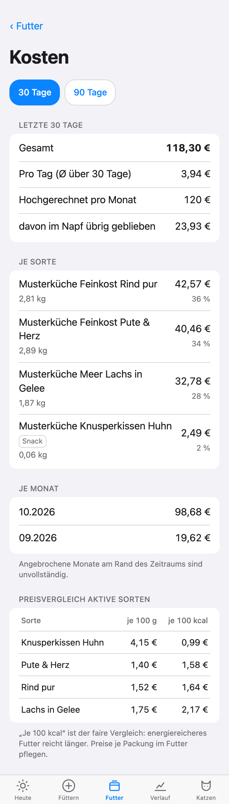

# Katzenfutter für Home Assistant

[](https://github.com/svenstrozyk/ha-katzenfutter/actions/workflows/tests.yml)
[](https://github.com/svenstrozyk/ha-katzenfutter/actions/workflows/images.yml)


Home-Assistant-Add-on, mit dem die ganze Familie die Ernährung der Katze im Blick behält: Was wurde gefüttert,
wie viel ist übrig geblieben, wie viele Snacks gab es, wie entwickelt sich das Gewicht – und welches Futter mag sie
wirklich. Mobile-first, als Panel in der HA-Seitenleiste, auch für Benutzer ohne Admin-Rechte.

<p>
  
  
  
</p>

## Funktionen

**Im Alltag (jede Erfassung in wenigen Sekunden)**
- **Füttern:** Sorte wählen (die angebrochene Packung steht oben), Menge per Schnellwahl, fertig. Der Bestand wird
  fortgeschrieben, Fehleinträge lassen sich 30 Minuten lang zurücknehmen.
- **Rest:** geschätzt mit einem Tipp (nichts, wenig, Hälfte, viel, unberührt) oder gewogen; „verweigert“ getrennt
  von „unberührt“. 30 Minuten nach dem Füttern kommt eine Mitteilung mit Knöpfen, die den Rest direkt eintragen.
- **Snacks:** mit „gegeben von“, Obergrenze 10 % des Tagesbedarfs und Tageslimit für die Kinder.
- **Gesundheit:** Erbrechen, Haarballen, Durchfall, weicher Kot – automatisch der letzten Mahlzeit zugeordnet,
  mit Tierarzt-Hinweisen (Blut, Apathie, mehrfaches Erbrechen, Durchfall über 48 h, keine Futteraufnahme) –
  auf Wunsch sofort als Mitteilung aufs Handy.

**Auswertung**
- **Heute:** Tagesbedarf, gefressen, Snacks, verbleibende Menge in Gramm und Packungen, Wasser aus dem Futter.
- **Verlauf:** Gewicht als Tagesmedian mit 7-Tage-Trend und Hinweisen bei Verlust oder Zunahme, kcal je Tag.
- **Vorlieben:** Lieblingsfutter und „wird nicht gemocht“ je Sorte, Marke, Textur und Hauptprotein – gerechnet gegen
  die übliche Akzeptanz über alle Futter, damit ein schlechter Tag nicht als Abneigung gilt.
- **Kosten:** je Tag, Monat und Sorte, Preisvergleich je 100 kcal.
- **Bestand & Einkauf:** Reichweite je Sorte aus dem Verbrauch, „bald nachkaufen“, Lieferung für mehrere Sorten
  in einem Rutsch, knappe Sorten mit einem Tipp oder automatisch auf die Einkaufsliste von Home Assistant.

**Futterdatenbank**
- Barcode per Live-Kamera, Foto oder EAN-Eingabe; Produktdaten aus [Open Pet Food Facts](https://world.openpetfoodfacts.org).
- Deklaration per Live Text (iPhone, iPad, Mac) einfügen; kcal nach Atwater, wenn der Hersteller sie
  nicht angibt; Vergleich auf Trockenmasse.

**Integration**
- Sensoren per MQTT-Discovery (kcal, Futter, Gewicht, Bestand, Kosten, Tierarzt-Hinweis), ideal für Automationen.
- Mehrere Katzen, Haushalt mit Erwachsenen und Kindern, einstellbare Schwellen.
- Kinder erfassen und sehen alles; Profil, Futter, Katzen und Einstellungen ändern nur Erwachsene.
- Alle Daten bleiben lokal (SQLite unter `/data`, Teil jedes HA-Backups), dazu eine nächtliche Kopie für 7 Tage.

<p>
  
  
  
</p>

## Installation

1. In Home Assistant **Einstellungen → Add-ons → Add-on-Store → ⋮ → Repositories**
2. `https://github.com/svenstrozyk/ha-katzenfutter` hinzufügen
3. **Katzenfutter** installieren, **In Seitenleiste anzeigen** einschalten, starten

Voraussetzungen: Home Assistant OS oder Supervised, Mosquitto-Broker für die Sensoren, HA-App für Mitteilungen.
Einrichtung und Alltag Schritt für Schritt: [ANLEITUNG.md](ANLEITUNG.md).

## Fachliche Grundlage

| Größe | Rechnung |
| --- | --- |
| Ruhebedarf (RER) | 70 × kg^0,75 kcal/Tag |
| Tagesbedarf (MER) | RER × Aktivitätsfaktor (Wohnung kastriert 1,2 · Freigang kastriert 1,4 · Reduktion 0,8 nur auf Zielgewicht) |
| kcal ohne Deklaration | 3,5 × Rohprotein + 8,5 × Rohfett + 3,5 × NfE (modifizierte Atwater-Faktoren) |
| Snacks | höchstens 10 % des Tagesbedarfs, vom Hauptfutter abgezogen |
| Wasser | Richtwert 40–60 ml/kg/Tag aus Futter und Trinken |
| Vorliebe | Score = Σ w(a − Baseline) / (Σ w + 3), a = gefressen / angeboten |

Bei Freigängern sind Beute und Fremdfutter nicht erfassbar – maßgeblich ist der Gewichtstrend, nicht die
Kalorienbilanz. Alle Hinweise sind Hinweise, keine Diagnosen.

## Entwicklung

```bash
pytest
```

Lokal starten mit `DEV_MODE=1 DATA_DIR=/tmp/katzenfutter python3 katzenfutter/app/app.py` (Port 8099).
Demo-Daten für Screenshots: `python3 werkzeuge/demo_daten.py <leerer Ordner>`.

| Pfad | Inhalt |
| --- | --- |
| `katzenfutter/` | Add-on: `config.yaml`, Dockerfile, Flask-App unter `app/` |
| `tests/` | pytest-Tests |
| `werkzeuge/` | Demo-Daten |
| `docs/` | Screenshots |
| `.github/workflows/` | Tests und vorgebaute Images (ghcr.io) |

Drittsoftware: [ZXing](https://github.com/zxing-js/library) (Apache-2.0, mitgeliefert),
Produktdaten von Open Pet Food Facts (ODbL).

Die Screenshots zeigen Demo-Daten mit erfundener Katze, Personen und Sorten.

## Lizenz

MIT, siehe [LICENSE](LICENSE). Hinweise des Add-ons ersetzen keinen Tierarzt.
